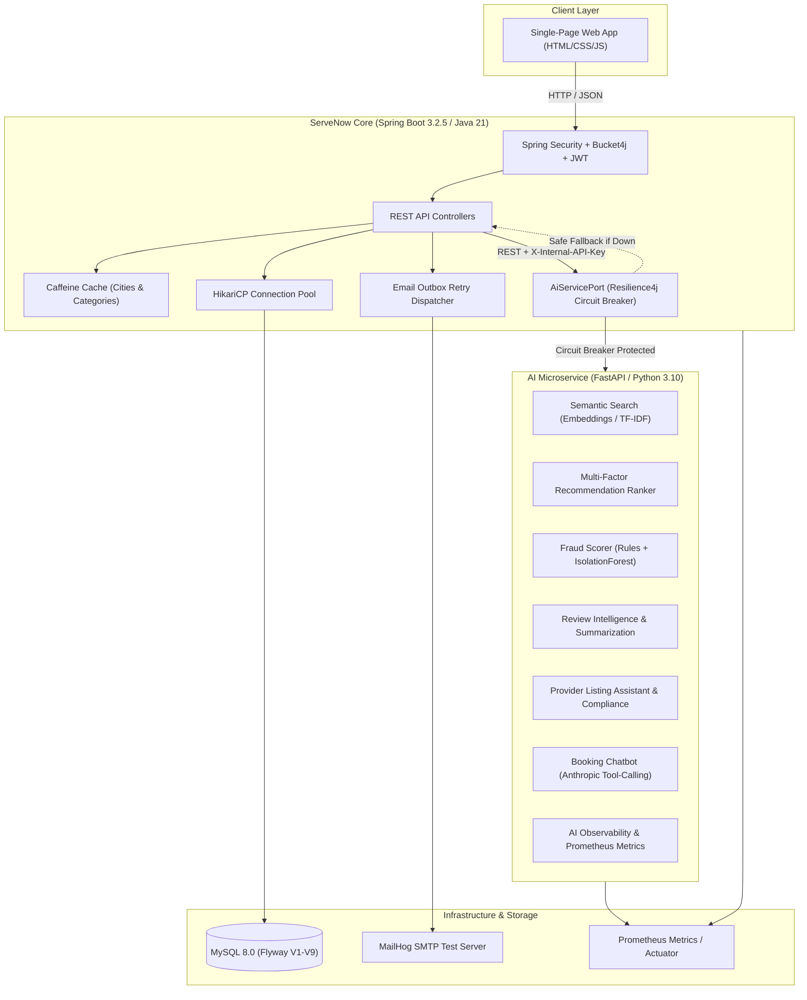

<div align="center">

# 🛠️ ServeNow
### *Enterprise On-Demand Smart Service Marketplace Platform & AI Microservice*

[](https://www.oracle.com/java/)
[](https://spring.io/projects/spring-boot)
[](https://fastapi.tiangolo.com/)
[](https://www.mysql.com/)
[](https://flywaydb.org/)
[](https://resilience4j.readme.io/)
[](https://www.docker.com/)
[]()

*An enterprise-grade, multi-city smart service marketplace connecting consumers with verified local service professionals (Plumbing, Electrical, Cleaning, Appliance Repair, Carpentry, Painting) backed by an AI Intelligence Microservice.*

---

[System Architecture](#-system-architecture) • [AI Microservice](#-ai-intelligence-microservice) • [Security & Payments](#-security--payments-engine) • [API Examples](#-api-specification--examples) • [Getting Started](#-getting-started) • [Docker Stack](#-docker-environment)

</div>

---

## 🏗️ System Architecture



---

## 🤖 AI Intelligence Microservice (`/ai-service`)

A dedicated Python FastAPI microservice providing machine learning and LLM capabilities:

| Feature | Endpoint | Description |
|---|---|---|
| **Smart Semantic Search** | `GET /api/v1/search/smart?q=&city=` | Maps free-text natural-language queries ("my tap is leaking") to categories and services. |
| **Recommendation Ranking** | `POST /api/v1/recommendations/rank` | Multi-factor scoring (rating 0.45, response rate 0.25, city 0.20, price 0.10) with humanized "why recommended" rationales. |
| **Payment Fraud Scoring** | `POST /api/v1/fraud/score` | Scores payments via heuristic rules (reference reuse, velocity spikes) + `IsolationForest` multivariate anomaly detection. |
| **Review Intelligence** | `POST /api/v1/reviews/analyze` | Evaluates sentiment score (-1.0 to 1.0) and detects spam, contact leaks, and rating contradictions. |
| **Review Summarizer** | `POST /api/v1/reviews/summarize` | Generates concise service summaries, positive feedback percentages, pros, and cons. |
| **Listing Assistant** | `POST /api/v1/listing/assist` | Auto-generates professional service descriptions, computes fair pricing percentiles, and screens policy violations. |
| **Booking Chatbot** | `POST /api/v1/chatbot/message` | Conversational assistant with tool calling (`search_services`, `create_booking_draft`), prompt-injection defense, and user authorization bounds. |
| **AI Observability** | `POST /api/v1/feedback` & `/metrics` | PII-masked call telemetry, Prometheus latency histograms, and admin retraining feedback loop. |

### 🛡️ Circuit Breaker & Fallback Guarantees
Spring Boot communicates with the AI microservice via `AiServicePort`. If `ai-service` is unreachable or times out (2000ms connect / 4000ms read):
- **Resilience4j Circuit Breaker** trips to prevent cascading failures.
- **Graceful Fallbacks** immediately activate:
  - Search falls back to database keyword queries.
  - Ranking falls back to rating/distance heuristics.
  - Fraud scoring falls back to deterministic UTR uniqueness checks.
  - Chatbot responds with a polite maintenance status directing users to manual tabs.
- **Zero Downtime Guarantee**: The core marketplace remains 100% operational even if the AI service is completely down.

---

## 💳 Security & Payments Engine

1. **Strict 12-Digit Numeric UTR Enforcement**:
   - Validated against `^[0-9]{12}$` at both DTO and Service layers.
   - Database-level unique constraint on `payments.upi_reference_id` prevents replay attacks.
2. **Payment State Machine**:
   - `PENDING -> AUTO_CONFIRMED -> VERIFIED | REVERSED`
   - Invalid transitions throw `IllegalStateException`.
   - Contact details (provider phone and address) remain strictly locked (`null`) until payment reaches `VERIFIED`.
3. **Idempotency Key Deduplication**:
   - Every payment request can supply an `Idempotency-Key` header.
   - Matching keys return the original transaction without duplicate processing or charges.
4. **Immutable Audit Trail**:
   - `payment_audit_logs` table records every lifecycle transition with `@Column(updatable = false)` and immutable repository constraints.
5. **Authentication & Rate Limiting**:
   - Single-use refresh token rotation with SHA-256 token hashing and token family reuse revocation.
   - Bucket4j rate limiting (5 login attempts/min) with account lockout after 5 consecutive failures.
   - Method-level `@PreAuthorize("hasRole('ADMIN')")` on all admin endpoints.

---

## ⚙️ Environment Variables

Copy `.env.example` to `.env` and configure:

| Variable | Default Value | Description |
|---|---|---|
| `PORT` | `8081` | Spring Boot HTTP server port |
| `DB_URL` | `jdbc:mysql://localhost:3306/marketplace_db...` | MySQL connection JDBC URL |
| `DB_USERNAME` | `marketplace_user` | MySQL database username |
| `DB_PASSWORD` | `marketplace_pass` | MySQL database password |
| `JWT_SECRET` | *(64-char hex)* | HS256 JWT signing secret key |
| `CORS_ALLOWED_ORIGINS` | `http://localhost:8081,http://localhost:3000` | Strict CORS allowlist |
| `MAIL_HOST` | `localhost` | SMTP mail server hostname |
| `MAIL_PORT` | `1025` | SMTP mail server port |
| `AI_SERVICE_URL` | `http://localhost:8000` | Python AI microservice endpoint |
| `AI_SERVICE_API_KEY` | `servenow-internal-ai-key-secret-2026` | Service-to-service internal API key |
| `ANTHROPIC_API_KEY` | *(optional)* | Anthropic API key for LLM booking concierge |
| `ANTHROPIC_MODEL` | `claude-3-haiku-20240307` | Anthropic model identifier |

---

## 🚀 Getting Started

### Prerequisites
- **JDK 21 LTS**
- **Maven 3.9+**
- **Python 3.10+** (for local AI microservice)
- **MySQL 8.0** (or Docker)

### Option 1: Run Locally

1. **Start the AI Microservice:**
   ```bash
   cd ai-service
   pip install -r requirements.txt
   uvicorn app.main:app --host 0.0.0.0 --port 8000
   ```

2. **Start the Spring Boot Marketplace:**
   ```bash
   mvn clean spring-boot:run
   ```

3. **Open the Application:**
   - Marketplace Web App: `http://localhost:8081`
   - Spring Boot Swagger UI: `http://localhost:8081/swagger-ui.html`
   - AI Service OpenAPI Docs: `http://localhost:8000/docs`
   - Prometheus Metrics: `http://localhost:8081/actuator/prometheus` and `http://localhost:8000/metrics`

---

## 🐳 Docker Environment

Run the entire multi-service stack with a single command:

```bash
docker compose up --build -d
```

### Stack Composition:
- **`marketplace_mysql`**: MySQL 8.0 database with persistent volume.
- **`marketplace_mailhog`**: SMTP test server (`1025`) with web inspection UI (`8025`).
- **`marketplace_ai_service`**: Python 3.10 FastAPI AI service with healthchecks (`8000`).
- **`marketplace_app`**: Multi-stage Java 21 Spring Boot marketplace running as non-root user (`8081`).

---

## 📡 API Specification & Examples

### 1. Smart Semantic Search
```bash
curl -X GET "http://localhost:8081/api/services/smart-search?q=my%20kitchen%20tap%20is%20leaking&city=Bengaluru"
```
**Response (200 OK):**
```json
{
  "query": "my kitchen tap is leaking",
  "detectedCategory": "Plumbing",
  "results": [
    {
      "id": 1,
      "title": "Emergency Pipe Leak Repair",
      "category": "Plumbing",
      "description": "Quick fix for broken pipes and leaking faucets.",
      "city": "Bengaluru",
      "price": 399.0,
      "rating": 4.8,
      "relevanceScore": 0.85
    }
  ],
  "total": 1
}
```

### 2. Multi-Factor Recommendations
```bash
curl -X POST "http://localhost:8081/api/services/recommendations?userCity=Bengaluru&limit=3"
```

### 3. AI Booking Chatbot
```bash
curl -X POST "http://localhost:8081/api/chat/message" \
  -H "Content-Type: application/json" \
  -H "Authorization: Bearer <JWT_TOKEN>" \
  -d '{
    "message": "I need a plumber for an urgent pipe leak",
    "conversation_history": []
  }'
```

### 4. Create Payment with 12-Digit UTR and Idempotency Key
```bash
curl -X POST "http://localhost:8081/api/payments" \
  -H "Content-Type: application/json" \
  -H "Authorization: Bearer <CUSTOMER_JWT>" \
  -H "Idempotency-Key: pay-idemp-994821" \
  -d '{
    "bookingId": 101,
    "upiReferenceId": "123456789012"
  }'
```

---

## 🧪 Running Automated Tests

```bash
# Run Spring Boot Unit & Integration Tests (57 tests)
mvn test

# Run AI Microservice Unit Tests (17 tests)
$env:PYTHONPATH="ai-service"; python -m pytest ai-service/tests

# Run Automated End-to-End Smoke Test Suite
python smoke_test.py
```
